# Aura — your day, organized

Aura is a calm, premium personal dashboard for Android. Today's tasks, upcoming reminders, your favorite apps and the latest news from your country all live on one home screen. It's built with Kotlin, Jetpack Compose and Material 3, with a soft pastel, glass-like design and a proper dark mode.

<p>
  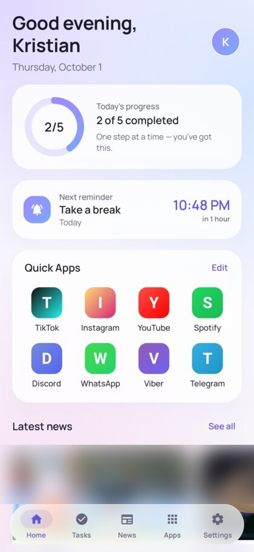
  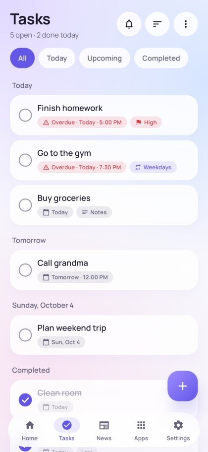
  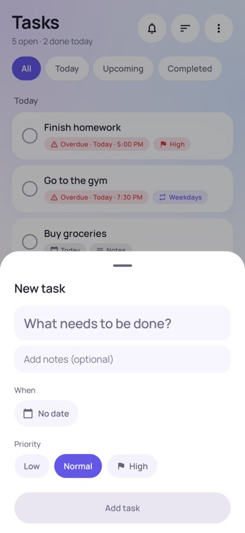
  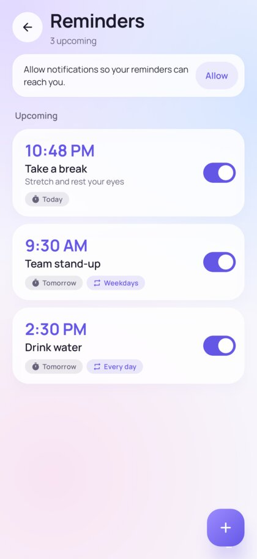
</p>
<p>
  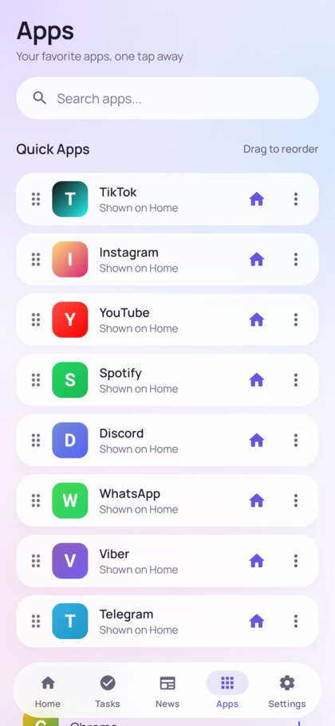
  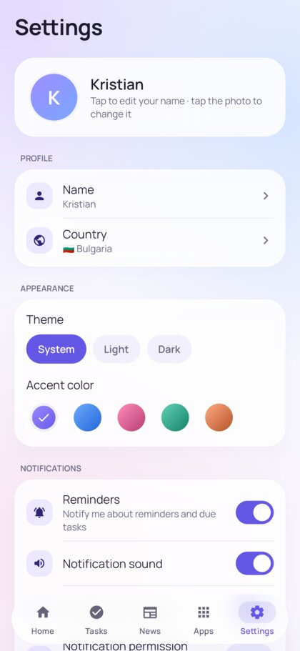
  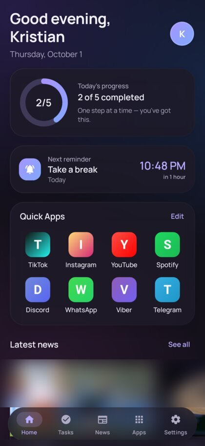
  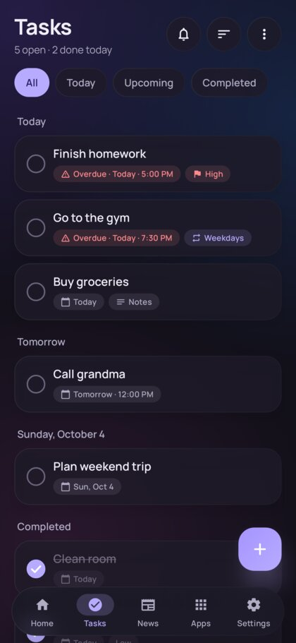
</p>
<p>
  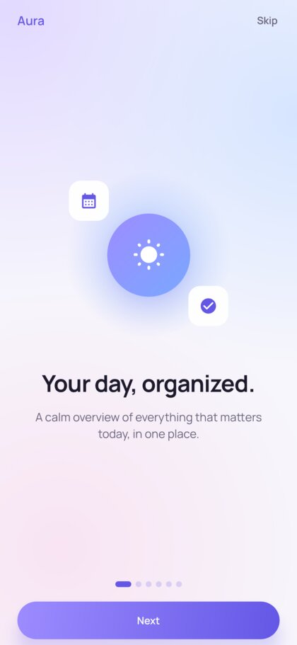
  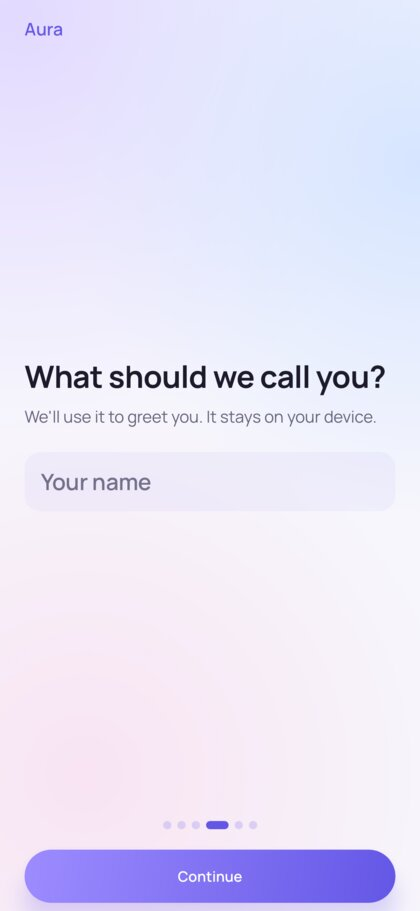
  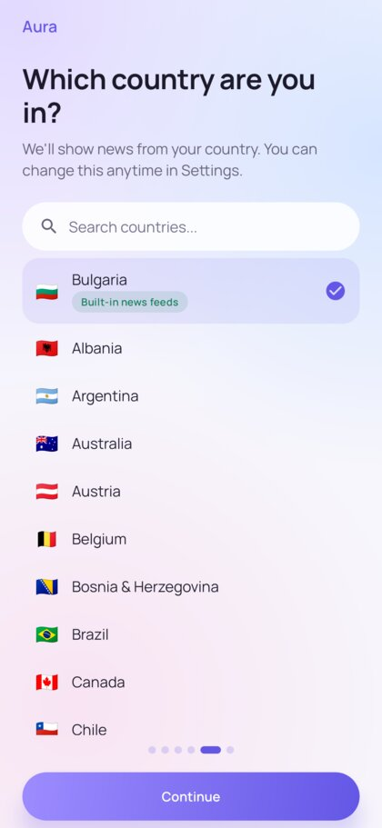
  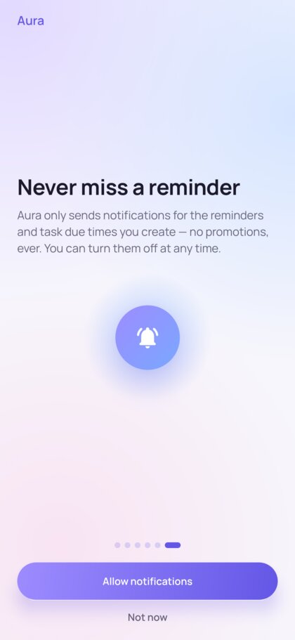
</p>

> Screenshots are rendered from the real app on the JVM (Robolectric) with sample tasks and placeholder app icons; see [Testing](#testing). Publishers' news photos are blurred, and the News screen screenshots aren't committed for the same reason. Generate them locally with the screenshot test.

---

## Contents

1. [Features](#features)
2. [Architecture](#architecture)
3. [Project structure](#project-structure)
4. [Requirements and setup](#requirements-and-setup)
5. [Building and running the APK](#building-and-running-the-apk)
6. [Configuring news (and the API key)](#configuring-news-and-the-api-key)
7. [Permissions](#permissions)
8. [Reminders and notifications](#reminders-and-notifications)
9. [Data storage](#data-storage)
10. [Quick Apps launcher](#quick-apps-launcher)
11. [Offline support and error handling](#offline-support-and-error-handling)
12. [Accessibility and responsiveness](#accessibility-and-responsiveness)
13. [Testing](#testing)
14. [Customizing](#customizing)
15. [Limitations](#limitations)
16. [Licenses](#licenses)

---

## Features

| Area | What you get |
|---|---|
| **Home dashboard** | Time-based greeting ("Good evening, Kristian") and today's date; an animated progress ring ("2 of 5 completed"); the next reminder with a live countdown; Quick Apps grid; a news carousel; today's tasks with animated checkboxes and quick add. |
| **Tasks** | Create, edit and delete tasks, mark them done or undo, with optional due date and time, notes, Low/Normal/High priority and repeat (daily, weekdays, weekends, weekly, monthly). Filters for All, Today, Upcoming and Completed; sort by time, priority or creation date; date-grouped sections; hide or clear completed tasks; undo after delete. Optional notification at the due time. |
| **Reminders** | Title, description, date, time and repeat (Never, Every day, Weekdays, Weekends, Weekly, Monthly). Each reminder can be paused or resumed. Notifications offer *Snooze 10 min*, and tapping one opens that reminder. Reminders survive app close, reboot and time-zone changes. |
| **Quick Apps** | Detects installed launchable apps, with search ("Search apps…"), add, remove, drag-to-reorder (plus accessible move up/down), custom names and "show on Home". Taps launch the real app. If an app is missing you get a friendly dialog with *Get the app* (Play Store) or *Open website*. |
| **News** | Real headlines for the selected country (default **Bulgaria**), with category chips, pull-to-refresh, skeleton loading, and empty, error and offline states. Every article shows its source and publication time and opens on the publisher's site in a Custom Tab. The latest results are cached for offline use. |
| **Settings** | Name, profile photo (system photo picker, no storage permission) and country. Light, dark or system theme with five accent colors. Toggles for reminders, sound and vibration, plus permission status, precise-timing access and battery-optimization guidance. News country, categories, article count and background refresh frequency. Manage Quick Apps. Show completed tasks and default priority. Version, privacy policy, terms and open-source licenses. |
| **Onboarding** | Three intro pages, then "What should we call you?", "Which country are you in?" (Bulgaria preselected) and an explained notification permission request. |
| **Dark mode** | A dedicated deep-charcoal/purple palette with lighter cards, pastel accents and correctly tinted system bars, rather than an inversion of the light theme. |

## Architecture

MVVM with a repository layer, unidirectional data flow and Hilt for dependency injection.

```
 UI (Jetpack Compose, Material 3)          ui/…           Screens, reusable components, theme
        │  StateFlow<UiState> / events
 ViewModels (Hilt)                         ui/*/…ViewModel
        │
 Repositories (interfaces)                 data/repository   TaskRepository, ReminderRepository,
        │                                                    NewsRepository, QuickAppRepository,
        │                                                    UserPreferencesRepository
 Data sources                              data/local (Room), data/preferences (DataStore),
                                           data/news (Retrofit + RSS), data/apps (PackageManager)
 Platform services                         notifications/ (AlarmManager, receivers, channels),
                                           work/ (WorkManager), core/network (connectivity)
 Pure domain logic                         domain/ (models, recurrence, task queries; unit-tested)
```

* **Offline-first.** Screens observe Room and DataStore flows, and network results are written into the cache. Every repository sits behind an interface (`OfflineFirstTaskRepository`, `CachedNewsRepository`, …), so a cloud-sync implementation can be added later without touching the UI.
* **Pure domain logic.** `Recurrence` (next occurrence, DST-safe) and `TaskQueries` (Today, Upcoming, sorting) have no Android dependencies and are covered by unit tests.
* **Tech stack.** Kotlin 2.4 · AGP 9.4 (built-in Kotlin) · Compose BOM 2026.09 (Material 3 1.4) · Navigation Compose (type-safe routes) · Hilt 2.60 · Room 2.8 · DataStore · WorkManager · Retrofit 3 + OkHttp 5 + kotlinx.serialization · Coil 3 · Haze (backdrop blur) · Reorderable · minSdk 26, targetSdk 36, compileSdk 37.

## Project structure

```
.
├── app/
│   ├── build.gradle.kts            # App module: SDK levels, BuildConfig (news config), signing, deps
│   ├── proguard-rules.pro          # R8 rules (serialization, Retrofit)
│   ├── schemas/                    # Exported Room schemas (for migrations)
│   └── src/
│       ├── main/
│       │   ├── AndroidManifest.xml
│       │   ├── assets/licenses/    # Apache-2.0 and OFL texts shown in-app
│       │   ├── res/                # strings, themes, adaptive icon, notification icons, Manrope font
│       │   └── java/com/aura/dashboard/
│       │       ├── AuraApplication.kt      # Hilt app, image loader, alarm restore, channel/worker sync
│       │       ├── MainActivity.kt         # Splash, edge-to-edge, theme, notification deep links
│       │       ├── core/                   # DI modules, clock, connectivity, HTML utils
│       │       ├── domain/                 # Models, Recurrence, TaskQueries
│       │       ├── data/
│       │       │   ├── local/              # Room database, entities, DAOs
│       │       │   ├── preferences/        # DataStore-backed preferences
│       │       │   ├── repository/         # Task, Reminder, News, QuickApp repositories
│       │       │   ├── news/               # NewsData.io client, RSS parser, curated feeds, countries
│       │       │   ├── apps/               # Installed apps, launcher, icon cache, known apps
│       │       │   └── profile/            # Avatar storage
│       │       ├── notifications/          # AlarmScheduler, receivers, notifier, channels, deep links
│       │       ├── work/                   # Background news refresh
│       │       └── ui/
│       │           ├── theme/              # Colors (light/dark, accents), typography, shapes
│       │           ├── components/         # GlassCard, AuraCheckbox, ProgressRing, chips, skeletons…
│       │           ├── navigation/         # Routes, NavHost, floating glass bottom bar
│       │           ├── home/ tasks/ reminders/ news/ apps/ settings/ onboarding/
│       │           └── util/               # Formatting, tickers
│       └── test/                   # JVM, Robolectric and screenshot tests
├── server/news-proxy/              # Optional Cloudflare Worker that hides the news API key
├── docs/screenshots/
├── gradle/libs.versions.toml       # Version catalog
├── build.gradle.kts, settings.gradle.kts, gradle.properties
└── .github/workflows/android.yml   # CI: unit tests, lint, debug build
```

## Requirements and setup

* **Android Studio** (a recent stable release that supports AGP 9.4), or the command line with **JDK 17+** (JDK 21 recommended).
* **Android SDK** with Platform **37** and Build-Tools 36+. If they're missing, Android Studio and AGP download them automatically after you accept the licenses.
* Clone the repo and open the root folder in Android Studio, or run the Gradle wrapper (`./gradlew`), which downloads Gradle 9.8 itself.
* For command-line builds, point Gradle at your SDK through `local.properties` (`sdk.dir=/path/to/Android/sdk`) or the `ANDROID_HOME` environment variable. `local.properties` is git-ignored.

**No API key is required.** Out of the box, news for Bulgaria, the UK and Germany comes from publishers' public RSS feeds.

## Building and running the APK

```bash
# Debug build (installable side by side with release: applicationId gets a .debug suffix)
./gradlew assembleDebug
adb install -r app/build/outputs/apk/debug/app-debug.apk

# Or build + install on a connected device/emulator in one go
./gradlew installDebug

# Tests and lint
./gradlew testDebugUnitTest lintDebug
```

### Release build

Release builds are minified and resource-shrunk with R8. To sign them, create `keystore.properties` in the project root (it is git-ignored):

```properties
storeFile=/absolute/path/to/aura-release.jks
storePassword=…
keyAlias=aura
keyPassword=…
```

```bash
keytool -genkeypair -v -keystore aura-release.jks -alias aura -keyalg RSA -keysize 4096 -validity 10000
./gradlew assembleRelease   # → app/build/outputs/apk/release/app-release.apk
./gradlew bundleRelease     # → app/build/outputs/bundle/release/app-release.aab (for Google Play)
```

Without `keystore.properties`, `assembleRelease` produces `app-release-unsigned.apk`.

## Configuring news (and the API key)

Aura picks a provider automatically:

| Configuration | Provider used |
|---|---|
| Nothing configured (default) | **Publisher RSS feeds**, keyless. Built-in for 🇧🇬 Bulgaria (BNT News, Dnevnik, Sega, 24 Chasa, Capital, Actualno, Kaldata, Gong.bg), 🇬🇧 UK (BBC) and 🇩🇪 Germany (tagesschau/sportschau). Other countries show a friendly "not available" state. |
| `aura.newsApiBaseUrl` and/or `aura.newsApiKey` set | **[NewsData.io](https://newsdata.io)** for every listed country and category, with RSS as an automatic fallback where it exists. |

All feeds are official syndication feeds published for this purpose. Nothing is scraped. Articles always open on the publisher's site.

### Recommended for production: a key-hiding proxy

An API key compiled into an APK can be extracted, so **don't ship one**. Deploy the included proxy instead, which holds the key server-side:

```bash
cd server/news-proxy
npx wrangler secret put NEWSDATA_API_KEY
npx wrangler deploy
```

Then add to `local.properties` (or export as an environment variable on CI):

```properties
aura.newsApiBaseUrl=https://aura-news-proxy.<your-subdomain>.workers.dev/
```

See [`server/news-proxy/README.md`](server/news-proxy/README.md). Any backend that exposes the same `GET /api/1/latest?country=…&category=…` contract works.

### For local development only: a direct key

```properties
# local.properties (never committed)
aura.newsApiKey=YOUR_NEWSDATA_KEY
```

or `export AURA_NEWS_API_KEY=…` before building. Values are read at build time in `app/build.gradle.kts` (local.properties first, then environment variables `AURA_NEWS_API_BASE_URL` / `AURA_NEWS_API_KEY`) and exposed through `BuildConfig`. They never live in source code.

### Adding keyless feeds for another country

Add an entry to `data/news/rss/RssFeeds.kt` that maps categories to one or more `FeedSource(publisher, url)` values. The parser handles RSS 2.0 and Atom, with images from `enclosure`, `media:content`, `media:thumbnail`, `<image>` or inline ``.

## Permissions

Aura asks for as little as possible:

| Permission | Why | When it's requested |
|---|---|---|
| `INTERNET` | Download news and images | Install time (normal permission) |
| `ACCESS_NETWORK_STATE` | Offline indicator; refresh when back online | Install time |
| `POST_NOTIFICATIONS` (Android 13+) | Deliver reminders and task alerts | At the end of onboarding, with an explanation. Can be re-requested from Reminders and Settings, or the app links to system settings once permanently declined. |
| `SCHEDULE_EXACT_ALARM` (Android 12+) | Fire reminders at the exact minute | Never forced. Reminders fall back to inexact alarms and the app offers an *Allow* button ("Alarms & reminders"). |
| `RECEIVE_BOOT_COMPLETED` | Restore reminders after a restart | Install time |

**Not used:** `QUERY_ALL_PACKAGES`, because app visibility comes from a narrow `<queries>` launcher intent; storage permissions, because the photo picker is used; location; contacts; and `USE_EXACT_ALARM`.

## Reminders and notifications

* **Scheduling.** `AlarmManager.setExactAndAllowWhileIdle` is used when exact alarms are allowed, otherwise `setAndAllowWhileIdle`, so reminders still fire in Doze. Each target (reminder, snoozed reminder, task due time) gets its own `PendingIntent` identity.
* **Repeats.** After a reminder fires, `Recurrence` computes the next occurrence in the current time zone. DST gaps are handled, and monthly reminders on the 31st fall back to the last day of shorter months.
* **Persistence.** `SystemEventsReceiver` restores every alarm on boot, app update, clock or time-zone change, and when exact-alarm access changes. Alarms are also restored on every app start, because force-stop clears them. A one-time reminder missed while the phone was off still notifies once.
* **Notification channel.** "Reminders" uses high importance. Android doesn't let apps change a channel's sound or vibration after creation, so each combination of the in-app toggles maps to its own channel ID, and the old one is removed.
* **Actions.** Tapping a notification deep-links to the reminder (highlighted) or opens the task editor. Reminders offer *Snooze 10 min*, tasks offer *Mark as done*, and both can be swiped away.
* **Battery.** Settings explains battery optimization and links to the exemption list. The restricted `REQUEST_IGNORE_BATTERY_OPTIMIZATIONS` permission is not requested.

## Data storage

* **Room** (`aura.db`) stores tasks, reminders, Quick Apps and the news cache, including the last-fetch time per country and category. The schema is exported to `app/schemas/`. Future schema changes must ship migrations; destructive fallback is enabled only for downgrades.
* **DataStore (Preferences)** stores the profile, country, theme, accent, notification and news settings, and task preferences. A corrupted file falls back to defaults.
* **Files:** the profile photo is copied to private storage as a 512 px JPEG.
* **Backups:** Android Auto Backup and device transfer include the database, preferences and avatar. Caches are excluded.
* Everything survives app restarts, process death and reboots. Nothing leaves the device except news requests.

## Quick Apps launcher

* `InstalledAppsSource` lists `ACTION_MAIN`/`CATEGORY_LAUNCHER` activities and updates live through package added/removed broadcasts.
* `AppLauncher` uses `getLaunchIntentForPackage`. For popular apps that aren't installed (`KnownApps`), it offers the Play Store listing (`market://`, with an `https://` fallback) or the app's website.
* On first run, installed popular apps (TikTok, Instagram, YouTube, Spotify, Discord, WhatsApp, Viber, Telegram, …) are pinned automatically. Any installed app can be added, and the list isn't hard-coded.

## Offline support and error handling

* Tasks, reminders, the launcher and settings are fully local. News shows the cached results with an **Offline** pill and refreshes automatically when connectivity returns, if the cache is stale.
* A background `WorkManager` job keeps headlines fresh. You choose the frequency in Settings: manual, or every 1/3/6/12/24 h. It runs only when the device is online and the battery isn't low.
* Each failure type maps to a specific, friendly message:

  | Failure | What the user sees |
  |---|---|
  | No connection | Offline state |
  | Rate limit | Rate-limited message |
  | Invalid key | Unauthorized message |
  | Malformed JSON or XML | "Invalid response" message |
  | Unsupported country | "Not available here" state |
  | App not installed | Dialog with Play Store or website options |
  | No browser | Snackbar |
  | Permission denied | Inline banners |
  | Alarm scheduling failure | Snackbar |
  | Database errors | Caught; the screen keeps working |

  External failures never crash the app.

## Accessibility and responsiveness

* Every icon button has a content description. Checkboxes, switches, tabs and chips expose proper roles and states, and headings are marked for TalkBack.
* Task completion is conveyed by check, strikethrough and fade, not color alone. Priority shows a flag and text. Overdue tasks get an icon plus "Overdue".
* Text colors were tuned for WCAG AA contrast in both themes. Touch targets are at least 48 dp. Text uses `sp` and scales with system font size.
* Layouts use weights, lazy lists and insets rather than fixed screen sizes. Edge-to-edge is handled with system bar insets, and the bottom bar is width-capped on large screens.

## Testing

```bash
./gradlew testDebugUnitTest
```

62 tests run on the JVM:

| Test class | What it covers |
|---|---|
| `RecurrenceTest` | Repeat rules, DST, month ends, recurring task roll-over |
| `TaskQueriesTest` | Today/Upcoming rules and sorting |
| `RssParserTest` | RSS and Atom, images, dates, malformed input; runs with and without XML namespace processing, as on Android |
| `NewsDataProviderTest` | Pagination, error mapping and malformed JSON, against a MockWebServer |
| `RssMergeTest` | De-duplication; future-dated items |
| `HtmlTextTest` | Entities, tag stripping, truncation |
| `RepositoriesTest` (Robolectric) | Room and real `AlarmManager` scheduling for tasks and reminders: recurring completion and undo, snooze, firing, disabling |

**Screenshot / end-to-end run (opt-in, needs internet).** This boots the real app with Hilt, Room, DataStore and live news feeds in Robolectric, then walks through every screen in light and dark mode:

```bash
./gradlew :app:testDebugUnitTest --tests '*AppScreenshotTest*' -Paura.screenshots=true
# → app/build/screenshots/*.png
```

## Customizing

| What | Where |
|---|---|
| App name | `app/src/main/res/values/strings.xml` → `app_name` (used everywhere, including notifications) |
| Application ID / version | `gradle.properties` → `aura.applicationId`, `aura.versionCode`, `aura.versionName` |
| Colors and accents | `ui/theme/Color.kt` |
| Typography | `ui/theme/Type.kt` (Manrope is bundled in `res/font`) |
| Launcher icon | `res/drawable/ic_launcher_*.xml` (adaptive and themed icon) |
| Suggested apps | `data/apps/KnownApps.kt` |
| News feeds | `data/news/rss/RssFeeds.kt` |

## Limitations

* Some manufacturers aggressively kill background apps. If reminders are late, exclude Aura from battery optimization (Settings → Notifications → Battery optimization).
* Without "Alarms & reminders" access on Android 12+, Android may deliver reminders a few minutes late. The app shows this clearly and offers a one-tap fix.
* Without a news API configured, keyless news covers Bulgaria, the UK and Germany.
* The frosted-glass blur behind the bottom bar needs Android 12+. Older versions get a translucent surface instead.
* The UI is in English. All strings are in `strings.xml`, ready for translation (e.g. `values-bg/`).

## Licenses

Aura uses open-source libraries under the Apache License 2.0 and the Manrope typeface under the SIL Open Font License 1.1. Both are listed in-app under Settings → About → Open-source licenses. News content belongs to its publishers.
